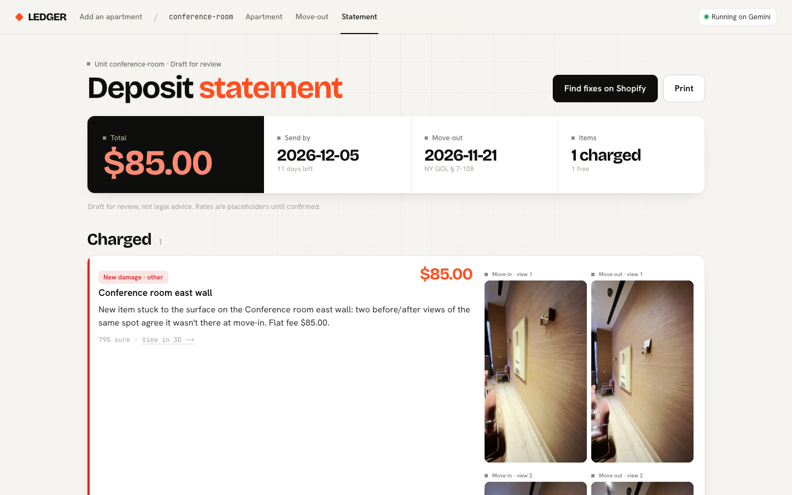
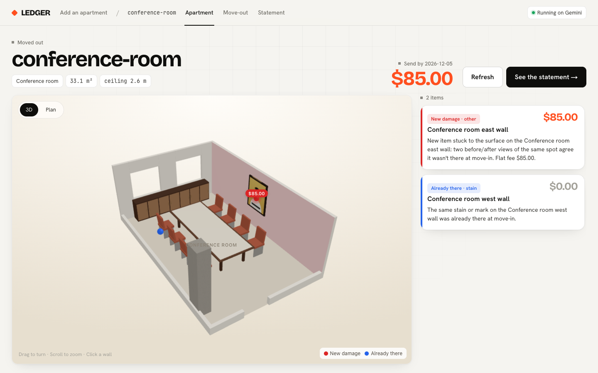
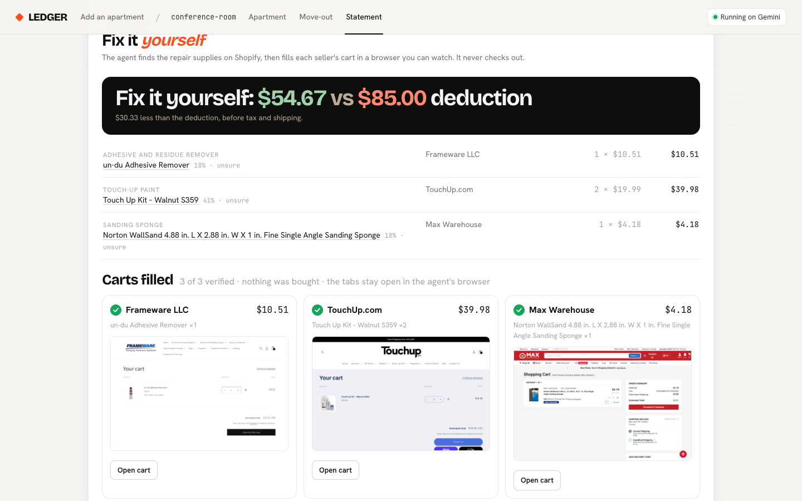

# LEDGER

**The deposit statement that proves every dollar. No proof, no charge.**

LEDGER compares an apartment's move-in and move-out walkthrough videos and writes the draft itemized security deposit statement a New York landlord has to send within 14 days of move-out (NY GOL 7-108). Every charge is backed by before and after frames of the same spot. Anything it can't prove costs $0, and the statement says why.

Built in one day at the Gemini 4 NYC Hackathon (Cerebral Valley x Google DeepMind), Nov 21 2026, Problem Statement One "5 Sigma", by Rahim Askarov, Alexandr Achapouski and Elmir Abdullaiev.



## How it works

1. **Plan.** The owner uploads a 2D floor plan (or scans the room with an iPhone). Gemini 4 Argon reads rooms, doors, windows and dimension labels. Plain code builds the walls, scale, areas and a 3D model, so no wall is invented by a model.
2. **Pin every frame to the plan.** Both walkthroughs are cut into sharp keyframes. The Decisions API (`gemini-decision-1`) decides which room and wall each frame shows, and a hidden Markov model smooths the labels across the video. We never compare video to video, because both passes share the same plan.
3. **Check each surface.** The Decisions API runs a damage checklist per wall with calibrated probabilities. Gemini 4 Carbon takes a second look only at uncertain cases, with a capped number of calls.
4. **Prove it or don't charge.** For each surface, before and after frame pairs must first pass "same region?". A charge needs **at least 2 agreeing pairs**. Otherwise the surface is *not provable* and costs $0. A moved chair costs $0.
5. **Statement.** Code computes amounts from a fixed price table. The statement shows the before and after frames per line and the send-by date. It is a draft for review, not legal advice.



## The tenant side: fix it yourself

"Find fixes on Shopify" turns each proven charge into a do-it-yourself repair kit. Fixed rules map the damage to repair needs with a price cap. Gemini 4 Hydrogen writes the search, matched to the wall's colour and finish. Shop MCP's `search_catalog` returns real products, the Decisions API picks one with a probability per candidate, and `create_checkout` builds one checkout per seller. A cart agent then opens a visible browser, adds each item with the store's own button and verifies the cart. **It never checks out:** `complete_checkout` can't be called from our client, and the tenant pays on the store's page.



| Model | Job |
|---|---|
| Gemini 4 Argon | Read the floor plan |
| Decisions API | Room and wall per frame, damage checklist, same-region and changed checks, product pick |
| Gemini 4 Carbon | Second look on uncertain calls, plan repair, the one-sentence reason on a charge |
| Gemini 4 Hydrogen | Landmarks per keyframe, Shopify search queries |
| Gemini 4 Neon | The evaluation baseline (one call, plan + both videos) |

## What we measured

Small samples from our own footage during the event, not a benchmark:

- **Plan reading:** Argon found every room, door and window on our test floor plans, with about 1% size error (`eval/plan-results.md`).
- **End to end:** on a before and after pair of a conference room, LEDGER charged the new item stuck to the east wall ($85.00, two agreeing pairs) and marked an existing stain on the west wall as already there at move-in. Each video took about a minute to process.
- **Fix kit:** 9 to 10 buyable products found for each of 3 repair needs, 3 real carts filled and verified at 3 stores, $54.67 of supplies against the $85.00 deduction.

The evaluation harness (`packages/eval`, `docs/eval-protocol.md`: held-out pairs staged by people outside the team, LEDGER vs a one-call Neon baseline) is built, but we did not collect that test set during the event, so there are no headline accuracy numbers yet. Failures we hit and fixed: [`eval/failures.md`](eval/failures.md).

## Run it

```bash
pnpm install
cp .env.example .env              # add GEMINI_API_KEY; GEMINI_MODE=mock runs without API calls
pnpm -r typecheck && pnpm -r test
pnpm dev                          # api + web
pnpm --filter @ledger/pipeline run:pair <plan> <baseline.mp4> <moveout.mp4>
pnpm eval                         # writes eval/results.md
```

The Gemini 4 models and the Decisions API were event access. Outside the event, use `GEMINI_MODE=mock` (or `replay` with recorded calls) to run the app without live calls. Shop MCP needs no key.

## Repo

| Path | What | Owner |
|---|---|---|
| `packages/shared` | The contract: TypeScript types + zod schemas, plan fixtures | Elmir |
| `packages/plan` | Plan parsing (Argon), geometry, surface IDs, `plan.svg`, RoomPlan scan to plan | Elmir, Rahim |
| `packages/eval` | Labelling page, Neon baseline, metrics, judge kit, proof slide | Elmir |
| `packages/gemini` | The only place that calls Gemini: client, Decisions wrapper, mock/record/replay, call log | Rahim |
| `packages/pipeline` | Frames, localization, findings, diff, pricing, fix kit | Rahim |
| `packages/shop`, `packages/cart-agent` | Shop MCP client and the cart agent | Rahim |
| `packages/viewer`, `apps/api`, `apps/web` | 3D viewer, API, web app | Alex |
| `apps/scanner` | iOS RoomPlan scanner | Rahim |

## Built during the event

Everything in this repository was written on Nov 21 2026 during the hackathon. The commit history is the record. The floor-plan fixtures in `packages/shared/fixtures/plans/` are hand-made shapes, not parsed listings.

## Limits

- No held-out test set yet, so no accuracy numbers; the end-to-end check is one real pair.
- Plain walls with nothing on them are hard to tell apart; one object per wall helps.
- Thresholds were tuned on our own development footage.
- Repair prices are placeholders in one config file.
- Not legal advice. The statement is a draft for the owner and tenant to review.
